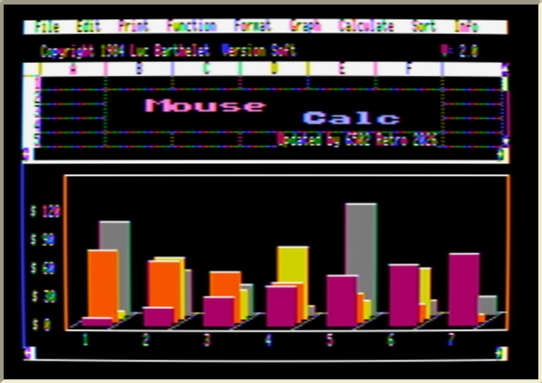
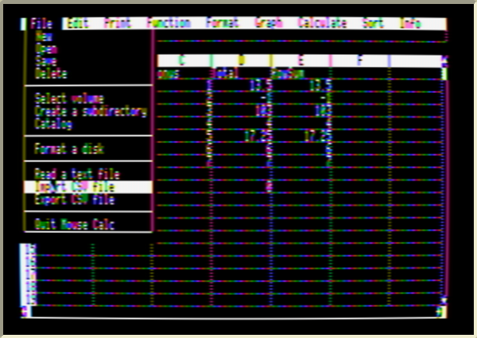
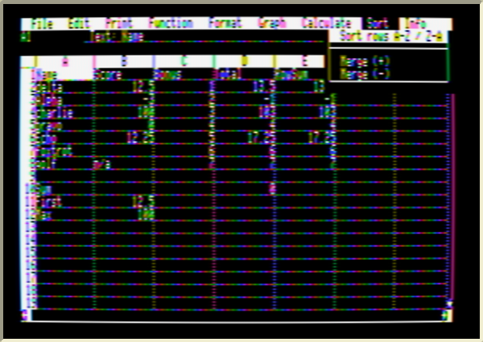
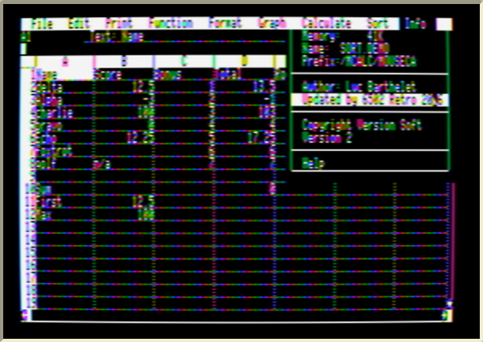

# Mouse Calc Version 2

**An unofficial 2026 update of _Mouse Calc_ (Version Soft, 1984) for the Apple IIe / IIc / IIgs — runs from a hard disk, sorts, and swaps spreadsheets with Excel and LibreOffice.**



Mouse Calc is Luc Barthelet's mouse-driven spreadsheet for 128K Apple II computers, published in English by Version Soft (the French original is *Version Calc*). It was written for floppies and a copy-protected key disk. This project patches the original program so it lives happily on a modern Apple II setup — a hard disk or CFFA/BOSS/MicroDrive card, Apple II DeskTop, or an emulator — and adds a few things a spreadsheet user in 2026 expects.

This repository contains **only new work**: 6502 source, patch scripts, tools and documentation. It does not contain Mouse Calc itself. You build Version 2 from your own copy of the original disks (see [Building](#building)).

---

## What's new

| | |
|---|---|
| **Runs from any folder on a hard disk** | No key disk, no floppy prompts. Launch `MCALC.SYSTEM` or `M.SYSTEM` from Apple II DeskTop, Bitsy Bye or any ProDOS selector, at any folder depth. |
| **Sort menu** | *Sort rows A-Z / Z-A* — numbers, then text (case-insensitive), blanks last; whole rows move; formulas in moved rows keep pointing at their own data. |
| **CSV import / export** | *File → Import CSV file* and *Export CSV file*. Standard RFC 4180 CSV that opens straight in Excel, LibreOffice, Numbers and Google Sheets — and reads files saved by them (UTF-8, semicolons, quoted text…). |
| **Open/Save in any folder** | The file box now shows **(Up a level)**; click it to climb folders and, at the top of a disk, pick another disk. |
| **Version 2 identity** | Info menu shows *Version 2* and *Updated by 6502 Retro 2026*; so does the start-up picture. |
| **Help** | New *SORT* and *WHATS.NEW* help pages, CSV page in *FILE* help. |
| **PC converter** | A single offline web page that converts Mouse Calc files to and from `.xlsx`/`.csv` on a PC ([converter/](converter/)). |

The DIF commands (and the "Copy to Mouse Word" link to Version Soft's word processor) were removed to make room; CSV replaces DIF.

<table><tr>
<td></td>
<td></td>
</tr><tr>
<td></td>
<td></td>
</tr></table>

More detail: [Sorting](docs/SORT.md) · [CSV](docs/CSV.md) · [Hard disk & DeskTop](docs/HARD_DISK.md) · [How it works](docs/INTERNALS.md) · [Version Calc 1.086 comparison](docs/VERSION_CALC.md) · [Changelog](docs/CHANGELOG.md)

---

## Getting Version 2

Mouse Calc itself is still copyrighted, so this project can't hand out finished disks. Instead it turns **your own copy** of the original disks into Version 2 in one step — download this repository (green **Code → Download ZIP** button, or the latest [release](../../releases)), add your disk images, run one command.

## Building

You need:

* your own image of the **Mouse Calc program disk** (`.woz`, `.po` or `.dsk`) — and ideally the **samples disk**, which adds the extra printer drivers, the sample sheets and the PC converter's examples;
* **Python 3.8+** — that's all;
* optional: **cc65** (`ca65`/`ld65`) to re-assemble the 6502 code yourself — without it the build uses the ready-assembled copies in [`prebuilt/`](prebuilt/) (`sudo apt install cc65`, `brew install cc65`);
* optional: **Node.js**, to generate the `SORT.DEMO` practice sheet.

```sh
git clone https://github.com/Adarjo6502/MouseCalc-2.0-for-Apple-.git
cd MouseCalc-2.0-for-Apple-
cp /path/to/"Mouse Calc - Program.woz" /path/to/"Mouse Calc - Samples.woz" originals/
python3 build.py
```

`build.py` checks every byte it patches against the original, so it refuses to run on a different release. Output, in `out/`:

| File | What it is |
|---|---|
| `MouseCalc_HDD.po` / `.2mg` | 32 MB bootable ProDOS hard disk: `MCALC.SYSTEM` + `MOUSECALC/` folder with program, help, printer drivers and samples |
| `MouseCalc_Program.po` / `.dsk` | 140K program floppy with the same layout as the original |
| `files/` | every new or changed file, for copying onto an existing disk by hand |
| `mouse-calc-converter.html` | the offline PC converter |

## Installing on your own hard disk

Copy the whole `MOUSECALC` folder from `MouseCalc_HDD.po` to wherever you like on your drive (Apple II DeskTop or CiderPress II will do it), plus `MCALC.SYSTEM` next to it if you want a one-click launcher. Then open the folder and run `M.SYSTEM`, or run `MCALC.SYSTEM`. Keep everything inside `MOUSECALC` together — Mouse Calc finds its help, printer drivers and add-on segments there. Details and troubleshooting: [docs/HARD_DISK.md](docs/HARD_DISK.md).

Upgrading an older copy of this update: replace `MOUSE.CALC`, `M.SYSTEM`, `MCALC.SYSTEM`, add `SORT.SEGMENT` and `CSV.SEGMENT`, delete `DIF.SEGMENT`, and replace the `HELP` folder.

## Requirements

Same as the original Mouse Calc: a 128K Apple IIe, IIc or IIgs with a mouse. The new 6502 code uses only original 6502 instructions. Tested in the [apple2js](https://github.com/whscullin/apple2js) emulator (enhanced IIe; ProDOS 1.1.1 and 2.4.3; Apple II DeskTop 1.6 built from source) and on a real user's Apple II DeskTop hard disk.

## Repository layout

```
build.py            one-step build from your original disks
src/                6502 assembly (ca65): Sort, CSV, launchers, small patches
prebuilt/           the same, assembled (used when cc65 isn't installed)
patch/              patch_mousecalc.py (all byte patches, each verified), splash_patch.py
help/               generators for the new help pages
demo/               SORT.DEMO generator
converter/          offline PC <-> Mouse Calc converter (HTML/JS) and its tests
tools/              WOZ / A2R flux decoders, ProDOS reader/writer, fsck, disassembly diff tools
test/               Playwright driver used to test everything in the apple2js emulator
docs/               documentation and screenshots
originals/          put your original disk images here (ignored by git)
```

## Credits and legal

*Mouse Calc* / *Version Calc* © 1984 Luc Barthelet and Version Soft. This is an unofficial fan update; it is not affiliated with or endorsed by the original authors or publishers. No original program code, help text, artwork or disk images are distributed here — the build reads them from disks you provide.

The new code, tools and documentation in this repository are © 2026 6502 Retro and released under the [MIT License](LICENSE).

Thanks to Antoine "LoGo" Vignau for preserving *Version Calc* 1.086 as a flux image, to the [apple2js](https://github.com/whscullin/apple2js) and [cc65](https://cc65.github.io/) projects, and to the [Apple II DeskTop](https://github.com/a2stuff/a2d) project, whose sources made testing the DeskTop launch path possible.
