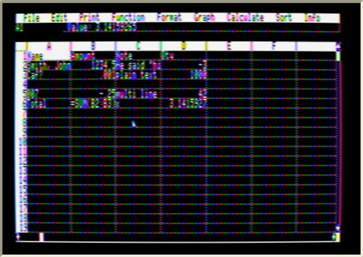

# CSV import and export

*File → Export CSV file* and *File → Import CSV file* exchange spreadsheets with Excel, LibreOffice Calc, Apple Numbers and Google Sheets.

## Export

Type a file name; `.CSV` is added if you give no extension. The used part of the sheet (row 1 to the last used row, column A to the last used column) is written as:

* comma-separated fields, CRLF line ends (RFC 4180);
* **numbers** plain, full precision, with a leading zero — `0.69`, `-1234567.89`, `0.000001`, `1E20`;
* **formulas** as their current results;
* **text** in double quotes, with `"` doubled inside;
* empty cells as empty fields.

The file is a ProDOS **TXT** file. Example — `SAMPLE.BILL` exported in the emulator ([sample-export.csv](sample-export.csv)):

```
"BILL",,,
,,,
"Item","Price","Quantity","Amount"
"Pears",0.69,19,13.11
"Apples",0.59,5,2.95
...
,,"Total",23.79
```

LibreOffice opens it with Price, Quantity and Amount as real numbers.

## Import



Import replaces the current sheet (you are asked whether to save it first) and shows a file window listing folders and **text (TXT) files**. It reads:

* comma, **semicolon** or **tab** separated files — the separator is detected from the first line;
* quoted fields containing commas, separators, doubled quotes and line breaks (a line break inside quotes becomes a space);
* CR, LF or CRLF line ends;
* a UTF-8 byte-order mark (Excel's *CSV UTF-8*), and Apple "high-bit" text files;
* decimal commas in semicolon files (`12,5` → 12.5);
* numbers like `-3`, `.5`, `+42`, `1E3`, `1e-7`.

An **unquoted** field that is a number becomes a number; everything else becomes text, so `"007"` stays `007` and `=SUM(B2:B3)` stays text.

## Limits

* **63 columns × 254 rows** — Mouse Calc's grid. Extra columns/rows are skipped and a message says so.
* **Memory**: Mouse Calc holds roughly 5,000 numeric cells (*Info → Memory* shows what is free). A larger file stops with Mouse Calc's normal memory-full error, keeping what was read.
* Characters the Apple II can't show (accents, emoji…) become `?`.
* The file must have type **TXT** on the Apple disk. When copying a CSV onto a disk image with CiderPress II or similar, give it type TXT.
* Speed: about 40 seconds for 3,000 cells.

## How it works

`CSV.SEGMENT` ([src/csv.s](../src/csv.s), 2.4 KB, 6502 only) replaces `DIF.SEGMENT` in Mouse Calc's overlay table and is entered through the same resident hooks, at `$B000` (import) and `$B003` (export). It talks to Mouse Calc only through the routines the DIF code already used: `$4021` (cell → text, numbers via Mouse Calc's own floating-point formatter), `$4024` (text → number, Mouse Calc's own parser), `$401E` (store text), `$4018` (grow the sheet), `$9431`/`$95D9` (create / pick and open a file), `$408F` (input line) and `$938D` (make a ProDOS file name).

Import reads the file **twice**. Mouse Calc re-lays out its entire grid in memory every time the sheet grows (`$4018`), and the original DIF reader grew it one cell at a time — about a quarter of a second per cell, roughly an hour for a large file. The CSV importer measures the file in a first pass, sizes the sheet once, rewinds and stores the cells in a second pass.

Tested in the emulator with files written by Python's `csv` module and LibreOffice, and by exporting each imported sheet again and comparing — see [test/README.md](../test/README.md).
