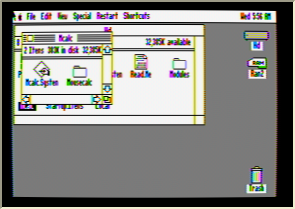
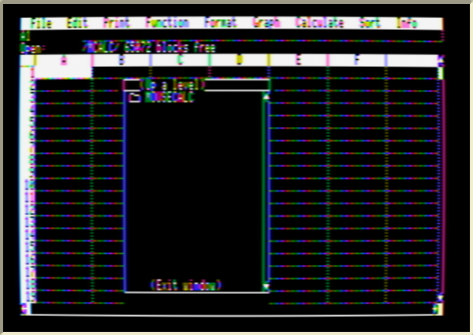
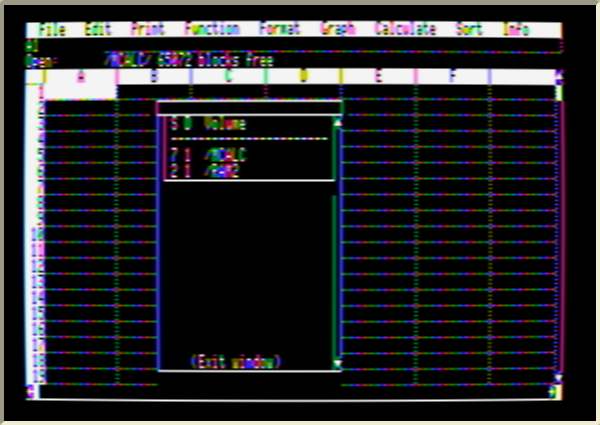

# Hard disk, Apple II DeskTop and launchers



## Layout

```
/MCALC/                    (any volume, any folder)
  MCALC.SYSTEM             optional one-click launcher
  MOUSECALC/
    M.SYSTEM               Mouse Calc's loader - launch this, or MCALC.SYSTEM
    MOUSE.CALC             the program
    FMT.SEGMENT  CSV.SEGMENT  SORT.SEGMENT
    HELP/   FILE EDIT PRINT FUNCTION FORMAT GRAPH SORT WHATS.NEW
    PRINTER/  DEF IW.IIC IW.IIE P.DMP EPSON P.EPSON + the ".2" variants
    SAMPLES/  SAMPLE.BILL SAMPLE.TAX SAMPLE.FORECAST TEMPLATES/ SORT.DEMO
```

The `MOUSECALC` folder can be renamed and put anywhere — `/HD/APPS/SPREADSHEETS/MOUSECALC` works. Everything inside it must stay together. Spreadsheets themselves can live anywhere: use **(Up a level)** in the file box, or *File → Select volume*.

 

## What was changed to make it work

| Problem in the original | Fix |
|---|---|
| Asks for the key disk in slot 6 drive 1 (copy protection) | The check at `$9005` is skipped, keeping the one setup call it made (`JSR $A9F7`, which installs a page-3 routine Help needs). |
| Program folder path kept in a 45-byte buffer right before code — deep folders overwrote the code, breaking *Open* | 20 references moved the buffer to the dead "Copy to Mouse Word" area at `$8C12` (121 bytes). |
| `M.SYSTEM` loads `MOUSE.CALC` from the *current prefix* and never checks for errors — if a launcher doesn't set the prefix, the Apple jumps into empty memory and reboots (on a DeskTop disk that looks like "goes straight back to DeskTop") | New `M.SYSTEM` ([src/msys.s](../src/msys.s)) tries the current prefix, then the paths in `$280`/`$380` and their parents, sets the prefix itself, then runs Version Soft's original loader. If `MOUSE.CALC` really is missing it says so and returns to the launcher. |
| — | `MCALC.SYSTEM` ([src/mcalc.s](../src/mcalc.s)) finds `MOUSECALC/` next to itself (or `M.SYSTEM` beside it) via the prefix, `$280`, `$380`, or the root of the boot volume, then runs it; again with a message instead of a silent quit. |

## Troubleshooting

* **"MOUSE CALC: CAN'T FIND MOUSE.CALC"** — `M.SYSTEM` and `MOUSE.CALC` aren't in the same folder. The message shows the folder it looked in.
* **"CAN'T FIND M.SYSTEM"** from `MCALC.SYSTEM` — keep `MCALC.SYSTEM` next to the `MOUSECALC` folder (or inside it next to `M.SYSTEM`).
* **Help or a printer driver gives an error** — the `HELP` and `PRINTER` folders must be inside the same folder as `MOUSE.CALC`. ProDOS limits a full path to 64 characters, so keep the folder path to about 50 characters.
* **Old copy goes back to DeskTop** — that was the launcher bug above; replace `M.SYSTEM` and `MCALC.SYSTEM`.
