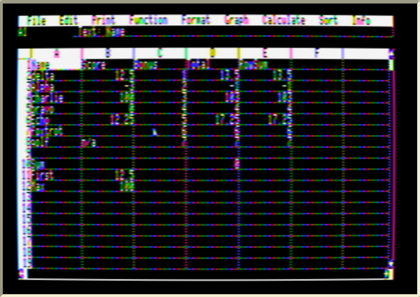
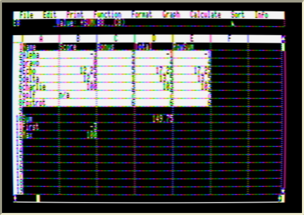

# Sorting rows

*Sort → Sort rows A-Z / Z-A* (the menu used to be called *Link*).

| Before | After sorting by column B |
|---|---|
|  |  |

1. **Select the rows** to sort — drag across them (any columns will do), or click a column letter to select every row in use.
2. Choose **Sort → Sort rows A-Z / Z-A**.
3. **Type the letter** of the column to sort by. *Return* uses the leftmost selected column; *Esc* cancels.

Rules:

* Whole rows move together.
* Order: numbers first (smallest first), then text A–Z ignoring upper/lower case, then empty cells. Equal keys keep their original order (the sort is stable).
* Choose *Sort rows* again on rows that are already in order to sort them **Z-A**.
* Formulas inside the sorted rows keep pointing at their own row's data — a row's `B4*C4` becomes `B7*C7` if that row moves to row 7. Formulas outside the sorted block are left as written and the sheet is recalculated, the same rule Excel uses.
* There is no undo; save first if you may want the old order back.
* Speed: about 15 seconds for 200 rows on a 1 MHz Apple II, including the recalculation.

`SAMPLES/SORT.DEMO` is a small sheet for trying it out (mixed case names, a negative number, a blank, text in a number column, row formulas and summary formulas below the data).

## How it works

The menu item loads `SORT.SEGMENT` into Mouse Calc's overlay area at `$AC00` with Mouse Calc's own overlay loader, so the program file only needed a 31-byte loader stub ([src/sortstub.s](../src/sortstub.s)). The segment ([src/sort.s](../src/sort.s), 1.6 KB, 6502 only):

* reads each row's key cell through Mouse Calc's own cell lookup (`$732C`) and slot reader (`$40AF`), so it works with any memory card Mouse Calc supports;
* caches a 16-byte key per row and merge-sorts the row numbers;
* moves rows by rewriting Mouse Calc's row map (`$BB1E`) — no cell data is copied;
* renumbers row references inside formulas of the moved rows;
* calls *Calculate now* and redraws.

The Sort menu also keeps *Merge (+)* and *Merge (-)* from the original Link menu, unchanged.
