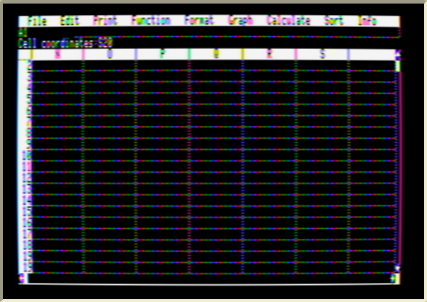

# Mouse Calc vs. Version Calc 1.086

*Version Calc* is the French original of Mouse Calc. To check whether the English release was missing any fixes from the last French version, a flux capture of the *Version Calc* 1.086 disk (Applesauce A2R, preserved by Antoine "LoGo" Vignau) was decoded with [tools/a2r2dsk.py](../tools/a2r2dsk.py): all 560 sectors read with good checksums.

## Result: same program, different language

`VERSION.CALC` and `MOUSE.CALC` are both exactly 60,240 bytes. Compared piece by piece (main program, both language-card banks, the toolkit, `FMT.SEGMENT`, `DIF.SEGMENT` and the printer drivers), with absolute addresses normalised and matched in both directions ([tools/coverage.py](../tools/coverage.py)), every run of five or more instructions in one program also occurs in the other. The differences are:

* French menus, messages and help;
* formula function names (`SOMME`/`SUM`, `MOYENNE`/`AVERAGE`, `SI`/`IF`, `VRAI`/`TRUE`…);
* accented letters in the font;
* character tables in the printer drivers;
* the start-up picture.

In other words, Mouse Calc is the English translation of the 1.086 code; its memory handling, mouse/timing code and formula engine are already the 1.086 ones. There was no code to port.

## "What's new" in 1.086

Version Calc's own help page `AIDE/NOUVEAUTES` lists four features. All four work in Mouse Calc (tested in the emulator); only the help page was missing, so an English version is now `HELP/WHATS.NEW`:

* **Format → Center** — center text and numbers.
* **Answer questions with the mouse** — click *Yes*/*No* in prompts like *Save this file? (Yes/No)*.
* **Jump to a cell** — type `>` and a reference, e.g. `>S20` *Return*.

  

* **Select a range wider than the screen** — click the top-left cell, scroll, hold *Open-Apple* and click the bottom-right cell.

Printer drivers: the French disk's `IMP/IW.2.IIC` exists in English on the Mouse Calc samples disk too, alongside the other ".2" drivers.
